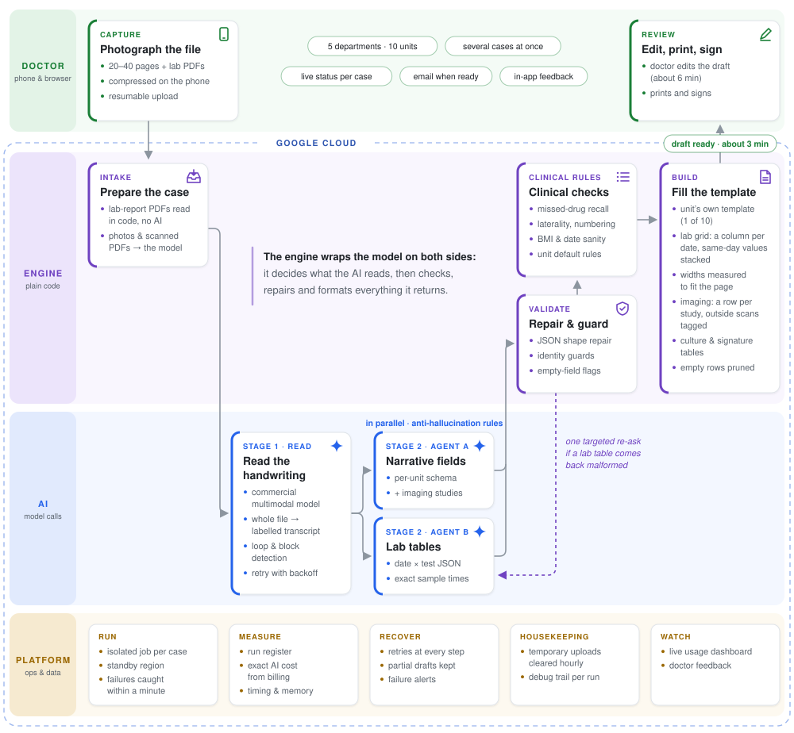
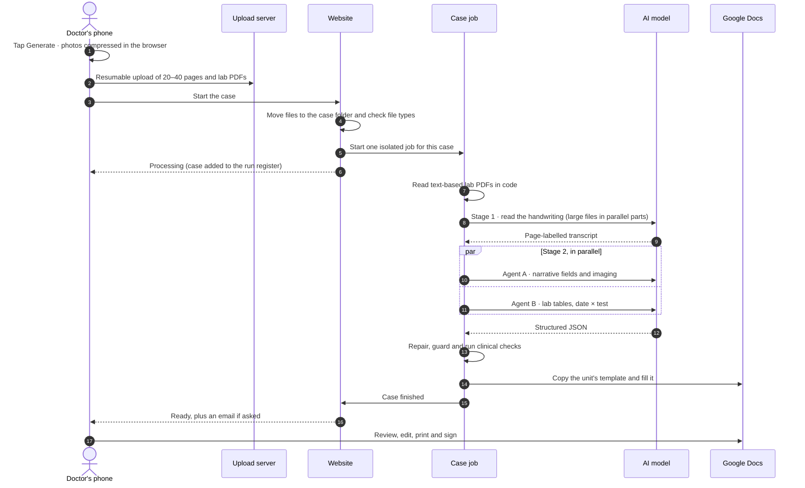

<h1 align="center">Discharge Desk: engineering notes</h1>

  How the system is built, the problems that took the most work, and how it stays reliable and affordable. 
  The production code is private because it runs on real patient data. This page explains the design without it.

  <a href="#at-a-glance">At a glance</a> ·
  <a href="#life-of-a-case">Life of a case</a> ·
  <a href="#tech-stack">Tech stack</a> ·
  <a href="#hard-problems-solved">Hard problems solved</a> ·
  <a href="#reliability">Reliability</a> ·
  <a href="#measurement">Measurement</a> ·
  <a href="#what-stays-private">What stays private</a>

## At a glance

  

| Layer | Runs as | What it does |
|---|---|---|
| **Doctor** | A web page on the phone | Picks the unit, photographs the case file, and later edits, prints and signs the summary |
| **Engine** | Plain Python, inside each case's job | Decides what the AI reads, then repairs, checks and formats everything it returns |
| **AI** | Model calls from the case job | Reads the handwriting; two agents extract the fields and the lab tables in parallel |
| **Platform** | Cloud services around the job | Runs, records, costs, cleans up and watches every case |

**Design principles**

- **The AI drafts; the doctor decides.** Nothing goes into a patient's file until a doctor has reviewed, edited and signed it.
- **Guarantee it in code.** When a rule must always hold, plain code enforces it after the AI step instead of relying on the prompt alone.
- **One case, one container.** Cases share nothing while they run.
- **Nothing important lives in memory.** Anything a second server might need is written to shared storage first.
- **Prove it on the real document.** A fix counts only after the generated document has been read back and checked.
- **Know the real cost.** Every AI call is tagged with its case, so the bill can be split case by case.

## Life of a case

The draft is ready in about **3 minutes**. The doctor then spends about **6 minutes** editing it, so the whole job takes **10–15 minutes** instead of 40–60 by hand.

## Tech stack

| Layer | Tools | Why |
|---|---|---|
| **Phone page** | HTML and JavaScript, Uppy with the tus protocol, browser-image-compression in a Web Worker, heic2any | Works on any phone with nothing to install. Uploads resume when ward Wi-Fi drops, and compression runs in the background so the page never freezes. |
| **Website** | Python, FastAPI, Cloud Run | Small and stateless. Scales to zero when idle and out when busy. It never opens a photo or calls the AI. |
| **Case processing** | Cloud Run Jobs, one container per case, Python | A case never depends on an open browser tab, and one heavy case can't slow or crash another. |
| **AI** | A commercial multimodal model through a managed API | Reads handwriting and photos. The engine decides what it sees and checks everything it returns. |
| **PDFs and images** | pdfplumber, Pillow | Hospital lab reports that carry text are read exactly, at no AI cost. |
| **Documents** | Google Docs, Drive and Sheets APIs | Each unit keeps its official template, and doctors edit in a familiar editor before printing. |
| **Operations** | Cloud Storage, Cloud Scheduler, Secret Manager, BigQuery billing export | Temporary file storage with hourly cleanup, scheduled helper jobs, no secrets in code, and the exact cost of each case. |

## Hard problems solved

### 1. Reading messy handwriting without getting stuck

**Problem.** On long, untidy files the model sometimes repeats the same few lines until it runs out of space, or refuses a page outright. One such loop made a single case cost about seven times the usual amount.

**Approach.** The engine checks every reply for repeating blocks and blocked answers, and retries with backoff. Large files are split into parts that are read in parallel, then joined, and the page labels are checked for gaps.

**Result.** These failures are caught and retried automatically instead of turning into a broken draft.

### 2. Lab tables that still fit the printed page

**Problem.** A long admission can mean dozens of tests over many days. Google Docs can't size a column to fit its contents, and the printed font's character widths aren't published, so the widths can't simply be calculated.

**Approach.** Agent B returns the labs as date × test JSON. The engine builds one column per date and stacks same-day repeat values in one cell. It then measures each column's real width by laying out the same text in a temporary spreadsheet and reading back its auto-fit width. If the table is still too wide, it narrows the label column, then gives the table its own page section with narrower margins, and only as a last resort makes the columns equal.

**Result.** A dense real case with nine date columns printed with no wrapped cells. The old character-count estimate had been up to about 80% too wide on longer values.

### 3. When the AI breaks its own format

**Problem.** In roughly 1 in 18 cases that included lab reports, the lab JSON came back in the wrong shape, for example with dates at the top level or with tests and dates swapped. The lab table then came out silently empty.

**Approach.** The engine recognises the known wrong shapes and rebuilds them in code. If a table is still empty, it asks the lab agent once more, for that table only.

**Result.** These cases recover on their own, at a fraction of the cost of running the whole case again.

### 4. Rules that must hold, enforced in code

**Problem.** Even with explicit instructions, the model now and then puts the patient's own name into a doctor field, leaves a drug off the treatment list, or keeps shorthand like "Rt" for a side of the body.

**Approach.** After the AI step, plain code enforces each rule:
- fuzzy matching keeps the patient's name out of doctor fields
- drugs that appear in the transcript but are missing from the treatment list are restored
- side markers next to anatomy become Left or Right
- lists are numbered
- BMI and admission dates are cross-checked, and a mismatch is logged, never written into the summary

**Result.** These rules hold on every case, whatever the model does on a given day.

### 5. Exactly one record per case, even with the browser closed

**Problem.** The website runs on several servers, and a doctor's page and the case's own "finished" report can arrive at the same second on two of them. Earlier, a case was recorded only when a page asked about it, so about a third of cases were recorded late, and a few never were.

**Approach.** The case job now reports its own end to the website. Whichever request arrives first takes a one-time claim in storage, using a write that succeeds only if the claim doesn't exist yet. Only that request writes the record and sends the email. Anything a second server might need is saved to shared storage when the case starts.

**Result.** The record is written 2–14 seconds after a case ends, and a finished case reported twice still produces one record.

### 6. Uploads from any phone, over ward Wi-Fi

**Problem.** Photos range from about 200 KB to 2 MB a page, iPhones send HEIC, some PDFs arrive with a photo's file name, and ward Wi-Fi drops mid-upload. Even moving a large case into its case folder was slow.

**Approach.** In the browser:
- HEIC photos are converted to JPEG
- photos above about 320 KB are compressed in a background thread, but never below 1800 px on the long edge, so handwriting stays readable
- every compressed photo must open correctly, or the original is sent instead

Uploads go in resumable 5 MB pieces. On the server, each file's type is read from its bytes rather than its name, and files are copied in parallel.

**Result.** Moving a 29-photo case into its case folder dropped from 72 seconds to 8.5. A dropped connection resumes instead of starting over.

### 7. A memory leak that wasn't ours

**Problem.** The website restarted nine times in one week after running out of memory, mostly during busy stretches.

**Approach.** Measurement traced it to the Google API client library. It builds a multi-megabyte help text for every API method each time a connection is created: about 36 MB stayed on every spreadsheet connection, and about 20 MB of garbage was left by every spreadsheet call. Switching that help text off leaves every API response unchanged.

**Result.** Idle memory fell from about 270 MB to about 110 MB. In the same load test, memory restarts went from 10 to 0 and failed requests from 7 to 0, with all 150 requests served in 39 seconds instead of 115.

### 8. Knowing the true cost of every case

**Problem.** Counting tokens didn't match the bill. Reasoning ("thinking") tokens and failed retries weren't included, so the early estimates showed only about 45% of the real cost.

**Approach.** Every AI call is tagged with its case. The engine records an instant estimate that includes failed attempts. Twice a day, a scheduled job reads the cloud bill's export and replaces each case's estimate with the exact billed amount.

**Result.** The cost is known to the rupee for every case, about ₹34 on average, and the instant estimate now lands within about 2% of the bill.

## Reliability

- **Isolation.** Every case runs in its own container with its own memory and time limit. A ready copy of the job waits in a second region, and switching to it is one setting.
- **Retries at every step.**

  | Step | Retry policy |
  |---|---|
  | Photo upload | up to 6 retries, waits growing to 20 s |
  | Each AI call | 3 attempts, with backoff |
  | Each part of the handwriting read | 3 attempts |
  | Copying the unit's template | 3 attempts |
  | Each batch of document edits | up to 5 retries |
  | Writing the run record | 6 attempts, over about a minute |
  | The job's "finished" report | 6 attempts |

- **Failure detection.** If a case has no result yet, the website asks the cloud platform whether its job has stopped. After a short grace period, the doctor sees the real error instead of an endless "processing".
- **Partial results are kept.** If one extraction agent fails, the document is still built from what worked and marked Failed, so the doctor knows to check it. If filling stops midway, the partly filled document is still linked.
- **Alerts.** The owner gets an email for every failed case and every AI error. The email contains no patient details.

## Measurement

Every case gets a row in the run register with:
- its status and AI cost
- the processing time, and the total wait including upload
- peak memory
- the number of AI errors

The register holds no clinical text.

## What stays private

The code, the prompts and per-unit rules, and the unit templates all stay private. The system runs on real patient data, and those parts are where most of the work is. This repository describes the design only. No patient data, names or identifiers appear in it.

---

<a href="README.md">← Back to the overview</a> · Made by <a href="https://github.com/arnabmedhi">@arnabmedhi</a>, a doctor at AIIMS Rishikesh.

