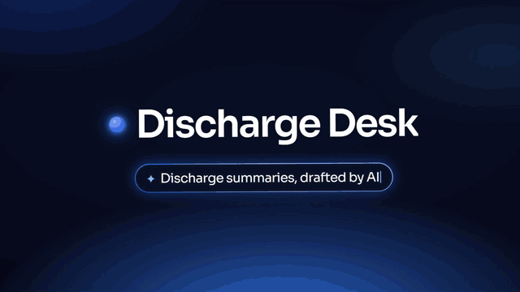
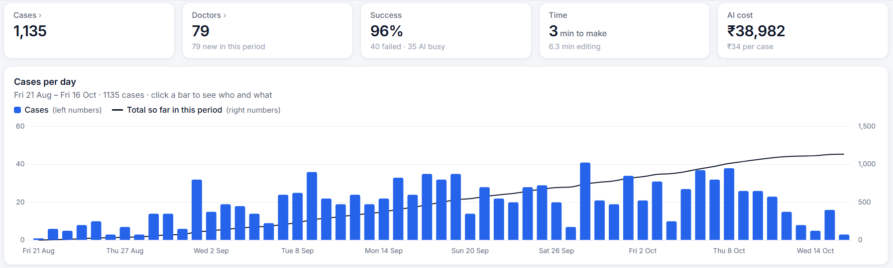
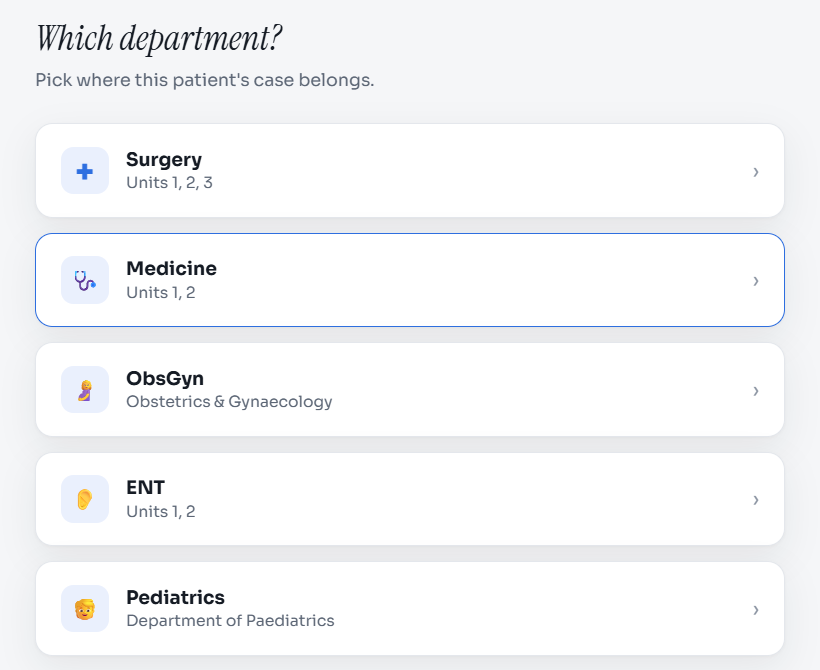
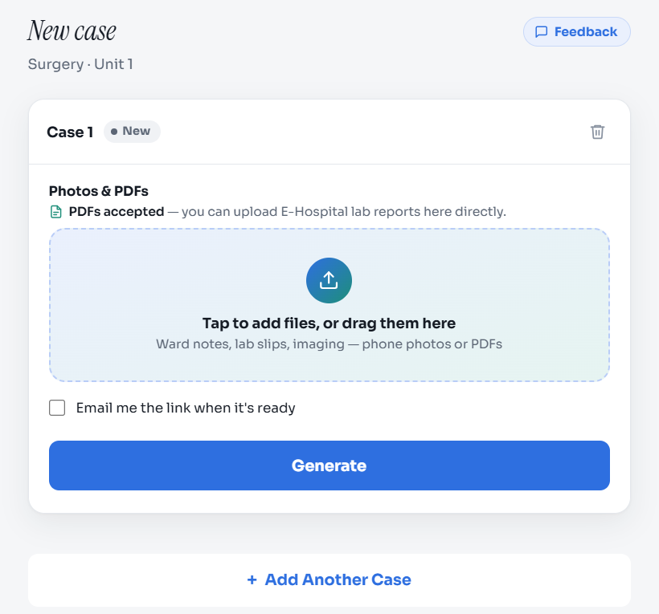
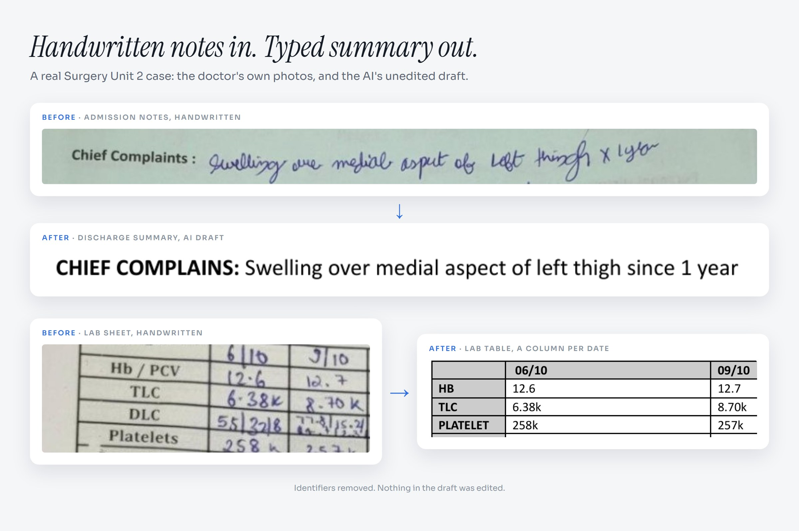
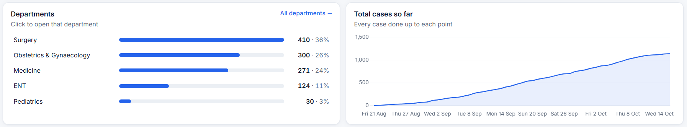

<h1 align="center">Discharge Desk</h1>

  <b>Phone photos of a handwritten case file in. The unit's official discharge summary out.</b> 
  Live at AIIMS Rishikesh since late August 2026.

  <a href="https://dischargedesk-452479289578.asia-south1.run.app"><b>Open the live app →</b></a> 
  Sign in with a Google account.

| **1,135** | **1,095** | **70+** | **5** | **10** |
|:---:|:---:|:---:|:---:|:---:|
| cases run | discharge summaries delivered | doctors | departments | units |

As of 16 October 2026. Departments: Surgery, ObGyn, Medicine, ENT and Pediatrics.

   
  <a href="demo/"><b>Watch the full demo (67 s) and see the whole case →</b></a> · a real case, identifiers removed

  

## The problem

Many hospitals still run on paper. A patient's case file is a stack of handwritten notes and charts plus printed lab reports, often 20 to 40 pages by the day they go home.

Before discharge, a doctor reads through all of it and types the discharge summary in their unit's own format. By hand, that takes **40 to 60 minutes per patient**.

## What Discharge Desk does

1. The doctor picks the department and unit.
2. They photograph the case file on a phone and add any lab PDFs.
3. About 3 minutes later, a draft summary is ready in that unit's own template.
4. The doctor checks and edits it, then prints and signs.

<table>
  <tr>
    <td width="50%" align="center" valign="top"> Pick the department and unit</td>
    <td width="50%" align="center" valign="top"> Add the photos and PDFs, then Generate</td>
  </tr>
</table>

  

|  | By hand | With Discharge Desk |
|---|---|---|
| **Time per summary** | 40–60 min | 10–15 min for the whole job |
| **Who does what** | the doctor reads and types everything | the AI drafts in about 3 min, the doctor edits for about 6 |

**Cost:** about ₹34 (40 US cents) per case.

## How it works

  

Four layers, each with its own job. The engine wraps the model on both sides: it decides what the AI reads, then checks, repairs and formats everything it returns.

- **Doctor.** Picks the unit, photographs the case file (20–40 handwritten pages plus lab PDFs) and uploads it. Photos are compressed on the phone, and the upload resumes if the connection drops. Several cases can run at once, each with its own live status, and an email arrives when the draft is ready. At the end, the doctor edits, prints and signs. The AI writes the draft; the doctor stays in charge of what goes in the file.
- **Engine (plain code), before the AI.** Hospital lab-report PDFs that already carry text are read directly in code. Photos and scanned PDFs go to the model.
- **AI.** A commercial multimodal model transcribes the whole file into a page-labelled transcript; large files are split into parts read in parallel, then joined and checked for missing pages. Loops and blocked replies are detected and retried. Two extraction agents then run in parallel: one writes the narrative fields and the imaging list, the other builds the lab tables as JSON (date × test). Each unit has its own schema, and both agents follow anti-hallucination rules.
- **Engine (plain code), after the AI.** Repairs the JSON's shape, guards identity fields, flags empty fields, and re-asks the AI once if a lab table comes back malformed. Clinical checks follow: missed-drug recall against the transcript, laterality and numbering, BMI and date sanity checks, and each unit's default rules. Finally it fills the unit's own template: a lab grid with a column per date and widths measured to fit the page, one imaging row per study with outside scans tagged, culture and signature tables, and empty rows removed.
- **Platform.** Each case runs in its own isolated job, with a standby region, and a crashed job is caught and reported within about a minute. Every run goes into a run register with its timing and exact AI cost from billing. Every step retries on failure, a partly finished draft is kept rather than lost, and failures alert the owner. Temporary uploads are cleared hourly, and a live dashboard and in-app feedback close the loop.

## Engineering highlights

- **One isolated cloud job per case.** Nothing depends on the doctor's browser staying open, and one heavy case can't slow down another.
- **Code on both sides of the AI.** Hospital lab PDFs are read exactly in code. After the AI step, code repairs its output and enforces the rules that must always hold.
- **Lab tables that fit the printed page.** One column per date, with each column's width measured, not guessed.
- **Exactly one record per case,** even with several servers running and the browser closed.
- **Exact cost per case,** taken from the cloud bill rather than estimated.

**Built with:** Python · FastAPI · Cloud Run services and jobs · Cloud Storage · tus resumable uploads · Google Docs, Drive and Sheets APIs · BigQuery · a commercial multimodal model

<a href="ENGINEERING.md"><b>Read the engineering deep-dive →</b></a> 
Life of a case, tech stack, the hard problems and how they were solved, reliability, and cost.

## Growth

  

## What's next: WardOS

**WardOS** is the next project: an agentic AI system that keeps a patient's whole case file up to date, answers questions about it, flags mistakes, and has the discharge summary ready the moment the patient is. Coming soon.

## About the code

Production code is private because it runs on real patient data.

This repository holds only this overview, the diagram, screenshots from the live app, and one real case in [`demo/`](demo/), shared with permission and with every identifier removed. Names and emails have been removed from the screenshots.

---

Made by <a href="https://github.com/arnabmedhi">@arnabmedhi</a>, a doctor at AIIMS Rishikesh.

